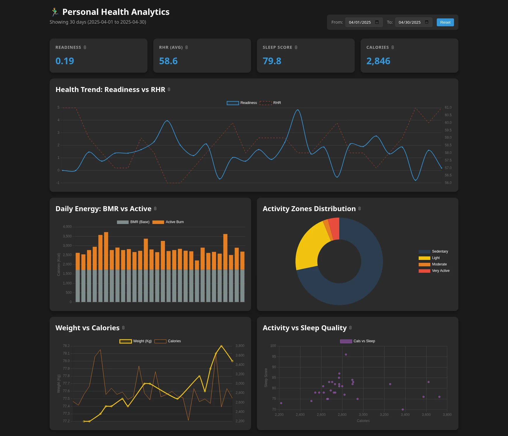
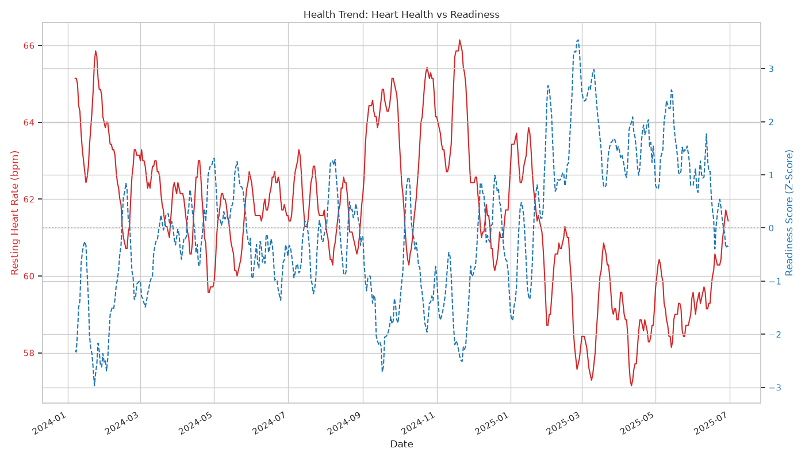
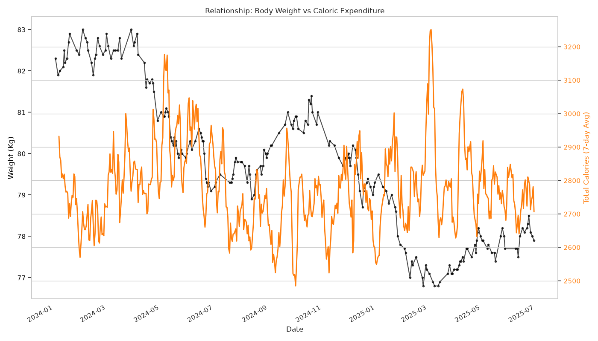
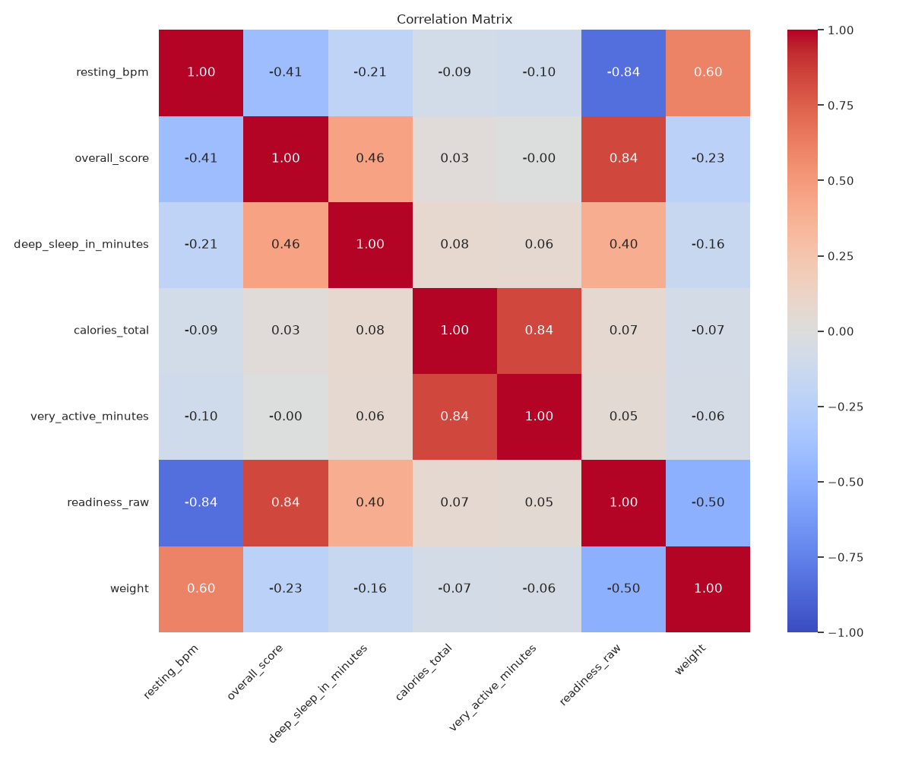
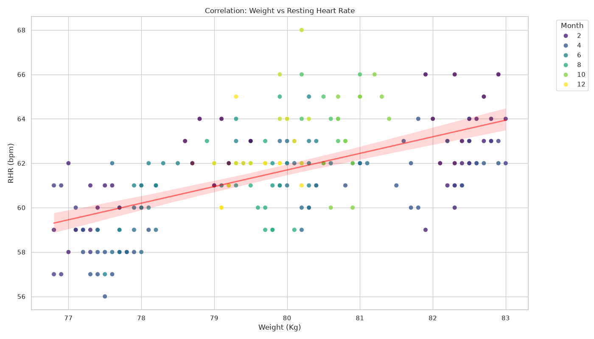
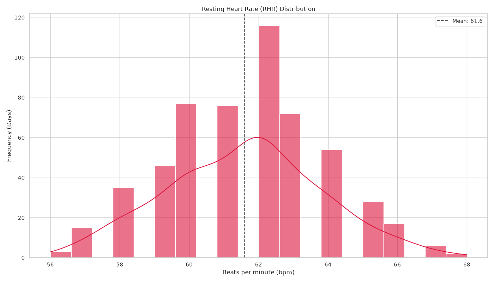
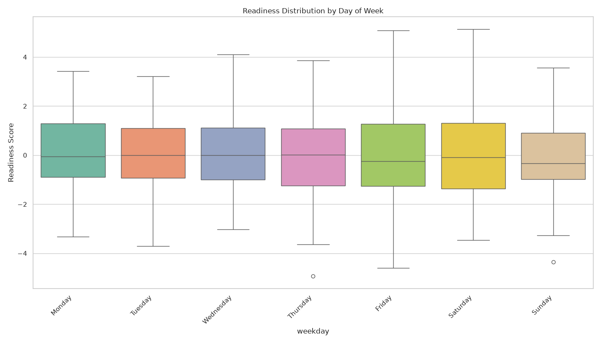
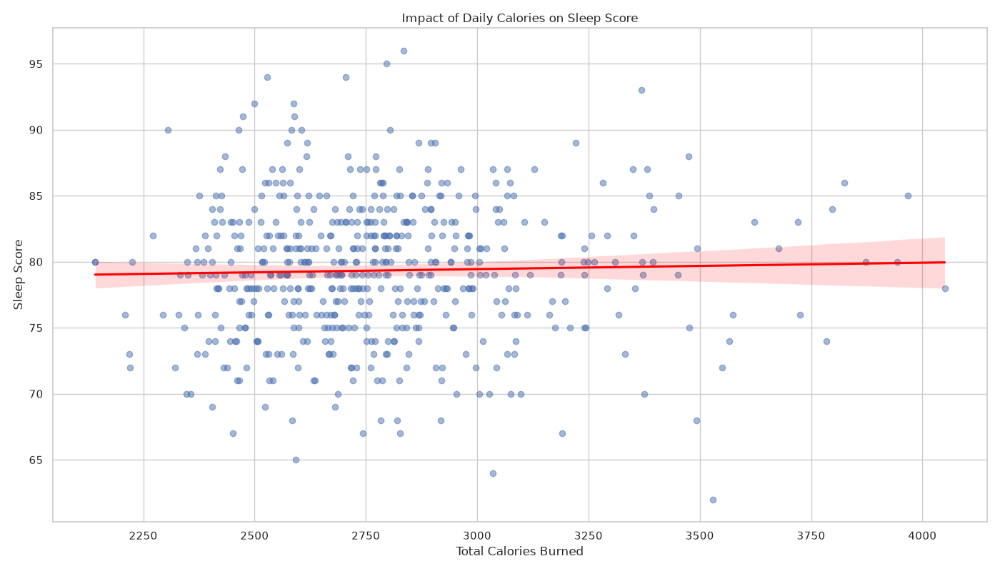

# Fitbit Personal Health Analytics & Dashboard V1

Old dashboard version deployed @ <https://jade-smakager-f829b3.netlify.app/>

A comprehensive local Data Engineering and Data Science pipeline to analyze, visualize, and benchmark personal health data exported from Fitbit.

This project uses **Python** for the ETL process (cleaning, merging, statistics, metabolic calculations) and **Node.js/Chart.js** for an interactive local dashboard.

## 🚀 Features

- **Multi-Format Ingestion:** Handles mixed granulaties (intra-day JSONs vs daily CSVs) and timezones automatically.
- **Data Standardization:** Automatically converts weights from Lbs to **Kg** and standardizes dates.
- **Custom Metrics:**
  - **Readiness Score (Z-Score):** Combines Sleep Quality and Resting Heart Rate (RHR) deviation to recommend training intensity.
  - **Metabolic Analysis:** Calculates **BMR** (Mifflin-St Jeor) vs **Active Calories**.
  - **Intensity Index:** Measures caloric burn per minute of activity.
- **Interactive Dashboard:** A modern, dark-mode web UI (Vite + Chart.js) featuring:
  - **Date Range Picker:** Filter analysis by specific periods.
  - **Activity Zones:** Doughnut chart breakdown (Sedentary vs Active).
  - **Energy Composition:** Stacked bar chart (BMR vs Active Burn).
  - Dual-axis trends and Dynamic KPI cards.
- **Daily Briefing:** A CLI script for a quick text-based check-up.

## 📂 Project Structure

```text
.
├── analyze.py              # ETL Engine: Loads data, calcs metrics (BMR/Readiness), exports JSON
├── visualize.py            # Static Viz: Generates PNG plots (Matplotlib/Seaborn)
├── daily_brief.py          # Reporting: CLI text summary
├── requirements.txt        # Python dependencies
├── README.md               # Documentation
│
├── dashboard/              # WEB DASHBOARD (Node.js)
│   ├── index.html          # Dashboard Layout
│   ├── main.js             # Charting Logic (Chart.js)
│   ├── style.css           # Dark Mode Styles
│   ├── package.json        # NPM Config
│   └── public/             # Served static files
│       └── dashboard_data.json # The processed data feed
│
├── data/                   # YOUR RAW DATA (Ignored by Git)
│   ├── Global Export Data/
│   ├── Sleep Score/
│   └── ...
└── plots/                  # Static images output
```

## 🛠️ Prerequisites

1. **Python 3.13+** (for Data Processing)
2. **Node.js 22+** (for the Dashboard)

## 📥 Installation

### 1. Python Setup (The Backend)

```bash
# Create virtual env
python -m venv .venv
source .venv/bin/activate # Windows: .venv\Scripts\activate

# Install libs
pip install -r requirements.txt
```

### 2. Node.js Setup (The Frontend)

```bash
cd dashboard
npm install
cd ..
```

## 🏃‍♂️ Usage

### Step 0: Configure User Metrics (Important!)

Open `analyze.py` and update the constants at the top with your personal data. This is required to calculate your **BMR (Basal Metabolic Rate)** correctly.

```python
# In analyze.py
USER_HEIGHT_CM = 123   # Update with your height
USER_AGE = 33          # Update with your age
USER_GENDER = 'male'   # 'male' or 'female'
```

### Step 1: Process Data (ETL)

Run this every time you add new files to the `data/` folder. It cleans the data and generates `dashboard/public/dashboard_data.json`.

```bash
python analyze.py
```

### Step 2: View Interactive Dashboard

Launch the local web server.

```bash
cd dashboard
npm run dev
```

> Click the link (e.g., `http://localhost:5173`) to open your dashboard in the browser.

📸 Screenshots:

> The screenshot and the plots in this README are generated from synthetic sample data.



### Step 3: Static Plots (Optional)

Generate high-res PNG images in the `plots/` folder for reporting.

```bash
python visualize.py
```

📸 Static Analysis Preview:

These plots are automatically generated by `visualize.py` based on your data.

### 📈 Health Trends

Long-term analysis of Readiness, Heart Rate, and Weight.

|     Health Trend (RHR vs Readiness)      |                 Weight vs Calories                  |
| :--------------------------------------: | :-------------------------------------------------: |
|  |  |

### 🔍 Correlations & Physiology

Understanding how different metrics interact (e.g., does Activity improve Sleep?).

|                 Correlation Matrix                  |               Weight vs Heart Rate                |
| :-------------------------------------------------: | :-----------------------------------------------: |
|  |  |

### 📊 Distributions

Daily patterns and distributions.

|            RHR Distribution             |                Weekly Readiness                 |              Activity vs Sleep               |
| :-------------------------------------: | :---------------------------------------------: | :------------------------------------------: |
|  |  |  |

### Step 4: Daily Briefing (CLI)

Get a quick text summary of your current form.

```bash
python daily_brief.py
```

## 📊 Analytics Logic

### 1. Readiness Score

Calculated using **Z-Scores** (Standard Deviations from your personal mean):

- `Readiness = (Sleep Z-Score) - (RHR Z-Score)`
- **Interpretation:** `> 1.0` (Peak), `0.0` (Average), `< -1.0` (Stressed).

### 2. Metabolic Metrics

- **BMR (Basal Metabolic Rate):** Calculated using the **Mifflin-St Jeor Equation** based on your config in `analyze.py`.
- **Active Calories:** `Total Calories - BMR`. Represents energy burned purely through movement.
- **Intensity Index:** `Active Calories / Total Active Minutes`. A measure of workout density/intensity (Kcal/min).

## 📄 License

Personal Use.
